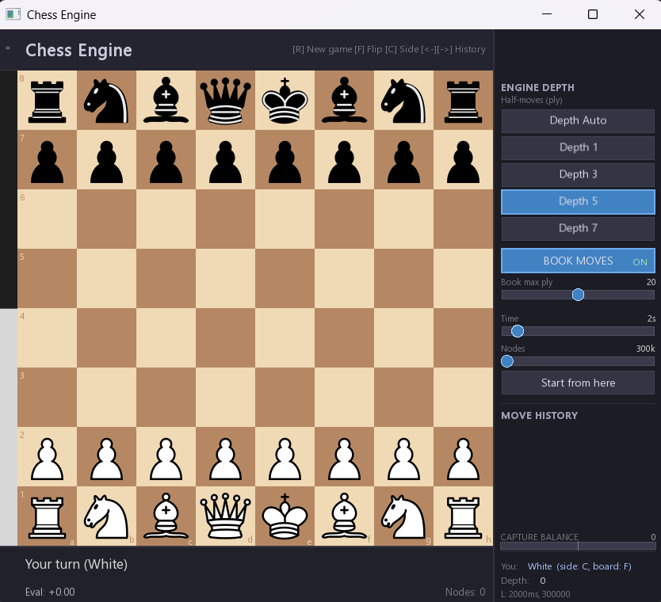
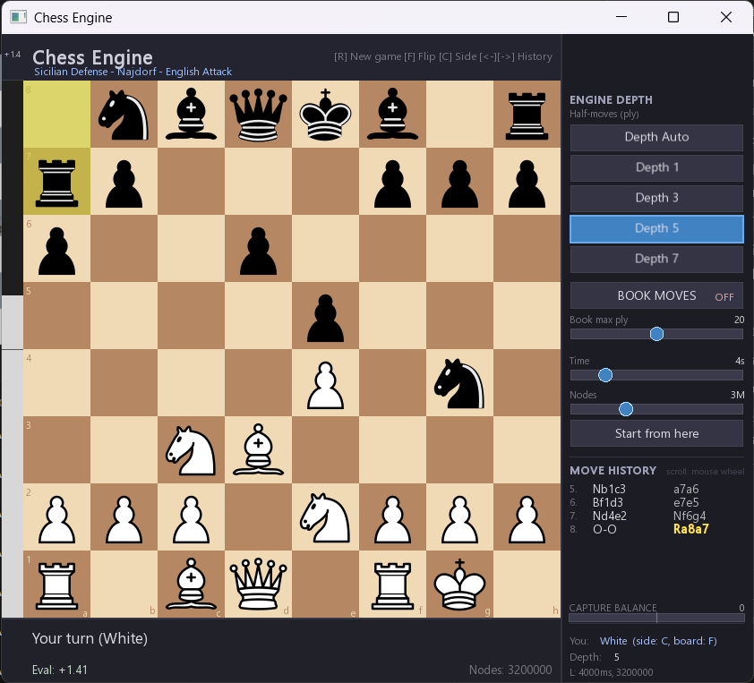
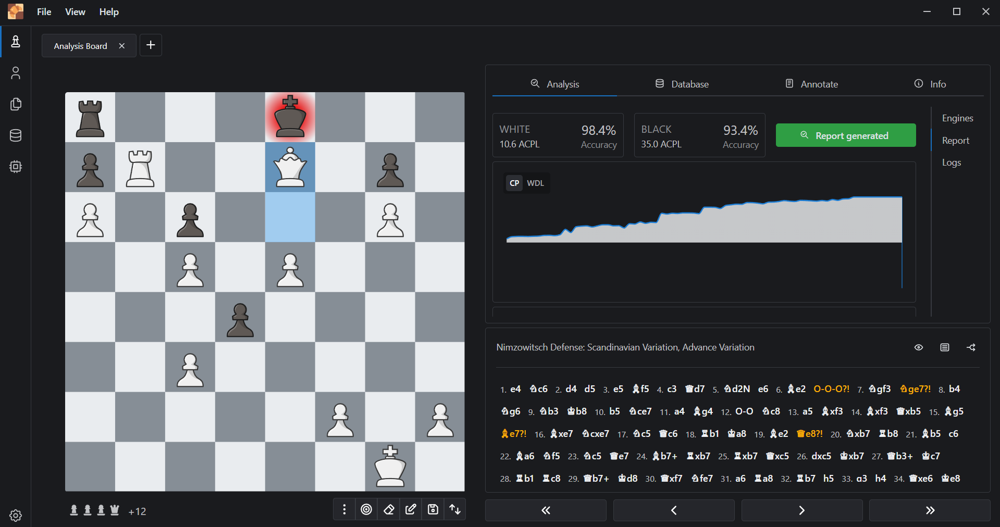

# ZeroFish Chess Engine

ZeroFish is a C++ chess engine with an SFML desktop GUI.  
The project combines practical engine-search techniques with a configurable opening-book workflow and tooling for quick benchmarking/regression checks.

## Screenshots

The GUI includes:
- board + move history
- adjustable search controls (`depth`, `time`, `nodes`)
- opening-book toggle and limits
- capture-balance bar and live engine stats

### Main GUI


### Example Game 


### Game vs Stockfish 18


## Features

- **Bitboard-based board representation**
  - Fast move-state operations using 64-bit piece bitboards.
  - Incremental state tracking for occupancy, side-to-move, castling rights, en-passant, and hashing.

- **Search stack (negamax + alpha-beta)**
  - Iterative deepening root search with aspiration windows.
  - Move ordering with TT move, captures, killer moves, and history heuristics.
  - Pruning/reduction methods (null-move, futility, LMR) with configurable tuning presets.
  - Draw detection integrated into search (threefold, 50-move rule, insufficient material).

- **Configurable search limits**
  - Fixed depth or auto-depth mode.
  - Hard caps for time and node count.
  - Runtime controls available directly in GUI sliders.

- **Opening book support**
  - External file: `assets/openings.book`
  - `BOOK MOVES` can be toggled in GUI.
  - If a matching line exists, book move is played; if not, engine automatically falls back to normal search.
  - Out-of-book state is indicated in the interface.

- **Game UX improvements**
  - Board flip, side swap, and move-history navigation (`<-` / `->`).
  - Promotion choice UI (Q/R/B/N) with keyboard and mouse selection.
  - Resizable window with ratio-safe viewport handling.
  - Capture-balance bar with dynamic scaling based on remaining material.

- **CLI tooling for engine development**
  - Benchmark mode
  - Regression suite mode
  - Tuning loop mode
  - Opening-book validation

## Build (Windows / MSYS2 + CMake)

Prerequisites:
- MSYS2 (MinGW-w64 UCRT64 or MINGW64 environment)
- `cmake`, `ninja`, `gcc`/`g++`
- SFML development package

Example (MINGW64 shell):

```bash
# 1) Configure
cmake -S . -B build -G Ninja -DCMAKE_BUILD_TYPE=Release

# 2) Build GUI + CLI
cmake --build build --target chess_gui chess_engine

# 3) Run GUI
./build/chess_gui.exe

# 4) Run quick CLI smoke test
./build/chess_engine.exe --bench --time 500 --nodes 300000 --depth 3
```

## Example Game (Stockfish 18 vs ZeroFish)

This sample game is based on the screenshot/game you shared:

- White: `Stockfish 18`
- Black: `ZeroFish`
- Result: `1-0`
- `BOOK MOVES`: `OFF` (ZeroFish played using its own evaluation/search only)

### Quick Notes

- ZeroFish held a playable position in the opening phase.
- `6...O-O-O?!` followed by `7...Nge7?!` weakened Black's king safety.
- White's queenside expansion (`b4-b5-a4-a5`) created long-term pressure.
- After `19...Qe8?!`, tactical pressure increased sharply in White's favor.
- The game converted into a forced mating net, ending with `38. Qxe7#`.

### Full PGN

```pgn
[White "Stockfish 18"]
[Black "ZeroFish"]
[Result "1-0"]

1. e4 Nc6 2. d4 d5 3. e5 Bf5 4. c3 Qd7 5. Nd2 e6 6. Be2 O-O-O?! 7. Ngf3 Nge7?! 8. b4 Ng6 9. Nb3 Kb8 10. b5 Nce7 11. a4 Bg4 12. O-O Nc8 13. a5 Bxf3 14. Bxf3 Qxb5 15. Bg5 Be7?! 16. Bxe7 Ncye7 17. Nc5 Qc6 18. Rb1 Ka8 19. Be2 Qe8?! 20. Nxb7 Rb8 21. Bb5 c6 22. Ba6 Nf5 23. Nc5 Qe7 24. Bb7+ Rxb7 25. Rxb7 Qxc5 26. dxc5 Kxb7 27. Qb3+ Kc7 28. Rb1 Rc8 29. Qb7+ Kd8 30. Qxf7 Nfe7 31. a6 Ra8 32. Rb7 h5 33. g3 h4 34. Qxe6 Ke8 35. gxh4 Kf8 36. h5 Ke8 37. hxg6 d4 38. Qxe7# 1-0
```

## Opening Book Format

Each line in `assets/openings.book` uses:

`Opening Name|Variation Name|uci_move_sequence`

Example:

`Sicilian Defense|Najdorf Variation|e2e4 c7c5 g1f3 d7d6 ...`

Current opening-name dataset source: [lichess-org/chess-openings](https://github.com/lichess-org/chess-openings)

## CLI

`chess_engine` supports:

- `--bench`
- `--regress`
- `--tune`
- `--validate-book`
- `--time <ms>`
- `--nodes <n>`
- `--depth <d>`
- `--book-file <path>`

### CLI Usage Guide

- `--bench`  
  Runs the benchmark suite on predefined test positions and prints move, reached depth, elapsed time, and searched nodes.

- `--regress`  
  Runs the regression suite to quickly check that current engine behavior is still stable after changes.

- `--tune`  
  Runs the built-in tuning loop over search presets (null-move/futility/LMR settings) and reports the best preset.

- `--validate-book`  
  Validates opening-book lines (format, legal move replay, short lines, duplicates) and prints a summary report.

- `--time <ms>`  
  Sets per-position time limit in milliseconds for bench/regress/tune runs.

- `--nodes <n>`  
  Sets per-position node cap for bench/regress/tune runs.

- `--depth <d>`  
  Forces fixed-depth search mode for CLI runs (`0` means auto-depth mode).

- `--book-file <path>`  
  Selects which opening-book file to validate when used with `--validate-book`.

### Common Command Examples

```bash
# Quick benchmark with custom limits
chess_engine --bench --time 2000 --nodes 1000000

# Regression check with fixed depth
chess_engine --regress --depth 5 --time 1200 --nodes 600000

# Full tuning loop with custom limits
chess_engine --tune --time 800 --nodes 400000

# Validate opening book file
chess_engine --validate-book --book-file assets/openings.book

# Combine validation + benchmark
chess_engine --validate-book --bench --time 1200 --nodes 600000
```

Example:

```bash
chess_engine --validate-book --book-file assets/openings.book
```
